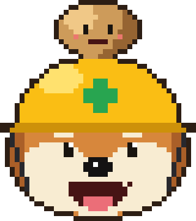

# Brattoi



Tiny AI potato for muOS. A small language model running on the handheld itself, on its own
screens. No cloud, no account.

- **Ask muOS:** ready-made help questions, answered from a bundled copy of the muOS docs and forum
  FAQ **as of October 2026**. Sources shown. muOS moves fast, so check <https://muos.dev> for
  anything newer.
- **Ask muOS your own question:** type a question.
- **Just for fun:** silly prompts.
- **Free chat:** talk to it.
- **Models:** download, switch or delete models.

Brattoi is a very small model doing its best. It makes mistakes and says silly things. It is a
demo of what the hardware and MustardOS can do. For real help, go to <https://muos.dev>.

## Devices

Tested on the **GKD Pixel 2** only. Should run on other aarch64 muOS devices, untested. Reports
welcome.

## Install

1. Download `Brattoi_v<version>.muxapp` from
   [Releases](https://github.com/Habbening/Brattoi/releases).
2. Copy it to `ARCHIVE/` on the SD card.
3. Install it with **Archive Manager**. Brattoi shows up in Applications.
4. Connect to WiFi. First launch shows the controls, then asks for a model ("Brattoi needs a
   brain"). Download one from **Models**.

Updating: install the new `.muxapp` the same way. Downloaded models and the chosen model are kept.

## Models

Downloaded from Hugging Face over WiFi, checked with SHA-256. A cancelled download resumes next
time.

| Model | Size | Good at |
|---|---|---|
| Granite 4.0 350M | 228 MB | Help answers (recommended) |
| Qwen2.5 0.5B | 353 MB | Chat |
| LFM2 350M | 219 MB | Some sense |
| SmolLM2 360M | 230 MB | Some sense |
| Gemma 3 270M | 242 MB | Not accurate |
| SmolLM2 135M | 92 MB | Not accurate |
| LFM2.5 350M | 219 MB | New in v0.14, not rated yet |
| Granite 4.0 H 350M | 216 MB | New in v0.14, not rated yet |
| Falcon-H1 0.5B | 304 MB | New in v0.14, not rated yet |
| LFM2 700M | 446 MB | New in v0.14, not rated yet |
| Qwen3.5 0.8B | 507 MB | New in v0.14, not rated yet |

The five new ones load and answer on the Pixel 2. How good they are is not known yet. Try them and
say how they do.

Get **Granite and Qwen** and pick **Auto**: Granite answers muOS questions, Qwen does the chats.

Speed on the Pixel 2, Granite and Qwen: about 5 to 7 tokens a second. A help answer takes about
30 to 60 seconds.

A model is only in memory while it works. Each help answer loads it and closes it after. A chat
keeps it loaded until the chat ends. In the menus nothing is loaded. So every help answer and
every new chat starts with a wake-up: Granite about 9 seconds, Qwen about 14.

## Controls

| Button | Does |
|---|---|
| Up / Down | Move, scroll a chat |
| A | Select |
| B | Back, end chat |
| A or X (in a chat) | Write a message |
| Menu | Quit |

Keyboard:

| Button | Does |
|---|---|
| D-pad + A | Type a key |
| B | Delete |
| Y | Space |
| X | Shift |
| L1 / R1 | Symbols |
| Start | Send |

The **Controls** page in the main menu shows this too.

If the screens fail to start, Brattoi opens in Mustard Terminal instead, as it did up to v0.12.
The reason is in `/tmp/brattoi-launch.log`.

## Build

Needs Python 3. The `llama-completion` binary comes from llama.cpp, cross-built for aarch64:

```sh
cmake -S . -B build-a64 -DCMAKE_SYSTEM_NAME=Linux -DCMAKE_SYSTEM_PROCESSOR=aarch64 \
  -DCMAKE_C_COMPILER=aarch64-linux-gnu-gcc -DCMAKE_CXX_COMPILER=aarch64-linux-gnu-g++ \
  -DCMAKE_BUILD_TYPE=Release -DGGML_NATIVE=OFF -DGGML_CPU_ARM_ARCH=armv8-a -DBUILD_SHARED_LIBS=OFF \
  -DLLAMA_CURL=OFF -DGGML_OPENMP=OFF -DLLAMA_BUILD_TESTS=OFF -DLLAMA_BUILD_SERVER=OFF \
  -DCMAKE_EXE_LINKER_FLAGS="-static-libgcc -static-libstdc++"
cmake --build build-a64 -j$(nproc) --target llama-completion
aarch64-linux-gnu-strip -o llama-completion build-a64/bin/llama-completion
```

Or take it out of a release `.muxapp` (`Brattoi/.brattoi/llama-completion`).

Package:

```sh
python build_muxapp.py path/to/llama-completion <version>
```

Writes `dist/Brattoi_v<version>.muxapp`.

Rebuild the docs pack (needs `pyyaml`):

```sh
git clone --depth 1 https://github.com/MustardOS/mustardos.github.io.git docs-src
python build_docs.py docs-src pack
```

Then set `DOCS_DATE` in `chat.py` to the month of the rebuild.

## Files

| File | What |
|---|---|
| `app/Brattoi/mux_launch.sh` | muOS launcher, starts `gui.py`, falls back to `chat.py` in Mustard Terminal |
| `gui.py` | The screens: menus, chats, keyboard, model manager |
| `sdl.py` | Calls the muOS SDL2 and SDL2_ttf libraries |
| `chat.py` | Menu texts, model choice, and the terminal version |
| `art.py` | Logo pixel art and animation |
| `ask.py` | Docs lookup, runs llama.cpp |
| `models.py`, `models.json` | Model list, download, delete |
| `build_docs.py` | Builds `pack/docs.jsonl` |
| `build_muxapp.py` | Builds the `.muxapp` |

## Credits

Logo: Brotato's avatar, used with their OK. The name came from SmolLM2 calling itself "Brattoi".
llama.cpp, the muOS docs and model licences: see [THIRD_PARTY.md](THIRD_PARTY.md).

MIT licence, see [LICENSE](LICENSE).
